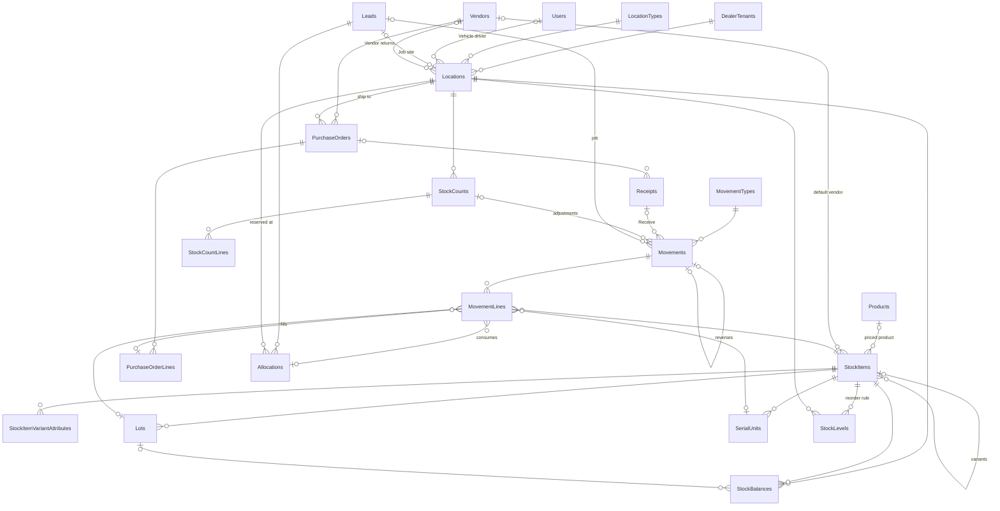

# INE: Inventory Engine for Solasta Lighting

The `INE` schema is Solasta's inventory system. It's adapted from the legacy NVL9_MAIN inventory engine (analysis in [legacy-ine/INE-Inventory-Engine.md](legacy-ine/INE-Inventory-Engine.md)). The ledger-based design is kept. The defects listed in that analysis are fixed, and the model is changed to fit permanent roofline lighting stock.

| | |
|---|---|
| Migrations | [20261117_1800_CreateINE_InventoryEngineTables](../Migrations/20261117_1800_CreateINE_InventoryEngineTables.sql), [20261117_1810_CreateINE_InventoryEngineProcedures](../Migrations/20261117_1810_CreateINE_InventoryEngineProcedures.sql), [20261117_1900_AddINE_AuditAndTenantGuards](../Migrations/20261117_1900_AddINE_AuditAndTenantGuards.sql) |
| Objects | `Tables/INE`, `Procedures/INE`, `Functions/INE`, `Views/INE`, `Triggers/INE`, `Data/INE`, `Schemas/INE` |
| Tests | [Scripts/Tests/INE/INE_EndToEnd_Tests.sql](../Scripts/Tests/INE/INE_EndToEnd_Tests.sql) (47 checks; run in a throwaway copy) |

## 1. The model in one paragraph

Every stock change is a **movement** in an append-only ledger (`INE.Movements` and `INE.MovementLines`). A movement has a type (Receive, Transfer, IssueToJob, and so on), a from location and/or a to location, and lines with positive quantities. **Balances** (`INE.StockBalances`) and **serial unit positions** (`INE.SerialUnits`) are projections of the ledger. One procedure, `INE.spMovementPost`, updates them in the same transaction as the movement, and CHECK constraints keep stock from going negative and keep allocated stock within what's on hand. Mistakes are corrected with a **Reversal** movement, never by editing history.

## 2. What changed from the legacy INE

| Legacy NVL9 INE | Solasta INE |
|---|---|
| Only serialized units; bulk stock faked with `ADHC-` barcodes, one row per unit | `StockItems.TrackingMode` = `Quantity`, `Lot` or `Serial`; quantities are `DECIMAL(19,4)` in `ft` or `each`, so 164.5 ft of rail is one line |
| SKU derived through the PO line, so every unit had to come from a PO | SKU on every line; opening balances (`AdjustIn`) and receipts without a PO work |
| Location = free-text `(LocationTypeId, LocationIdentifier)`, no FK | `INE.Locations` rows (Warehouse, Vehicle, Staging, Job, Vendor) with real FKs to users, leads, vendors |
| Current location = latest tracking row; two disagreeing readers; audit events moved stock | `StockBalances` + `SerialUnits.CurrentLocationId` maintained by one proc; `vwStockBalanceDrift` proves they match the ledger |
| No transactions | Every posting procedure is one transaction (`XACT_ABORT ON`); nested calls join the caller's transaction |
| Ledger rows soft-deleted to "undo" | Ledger is append-only (`tr_Movements_PreventChange`); `spMovementReverse` posts a Reversal |
| No over-receipt or PO status guard; ClosePO stamped the wrong date | `QuantityReceived <= QuantityOrdered` (CHECK + proc); status moves only through procs; lines locked after Draft (trigger) |
| No reservations | `INE.Allocations` reserve stock for a lead (job); reserved stock isn't available to others |
| Audits recorded as tracking events only | `StockCounts` + lines; posting creates AdjustIn / AdjustOut for the differences |
| `CONTEXT_INFO` user; dynamic SQL in `LocationTypes.SqlStmt` | Tenant and user from `SESSION_CONTEXT('UserContext')` (set by `ACC.spSessionContextCreate`); no dynamic SQL |
| No secondary indexes | Indexes for balances by location and item, serials by location, ledger by tenant and date, by lead, by serial |

## 3. Tables



| Table | Role | Written by |
|---|---|---|
| `LocationTypes`, `MovementTypes` | Seeded reference data with fixed IDs; read by `Code` | migrations / `Data/INE` |
| `Vendors`, `Locations`, `StockItems`, `StockLevels` | Master data | the API, plain CRUD |
| `StockItemVariantAttributes` | Name/value pairs of a variant (Color = Black) | the API, plain CRUD |
| `PurchaseOrders`, `PurchaseOrderLines` | Purchasing; lines editable only while Draft | the API (Draft), `spPurchaseOrderSetStatus`, `spMovementPost` |
| `Receipts` | Packing slips | `spReceiptPost` |
| `Lots` | Lots, reels or color bins | created by inbound movements (or the API) |
| `SerialUnits` | One row per serialized unit, with current location and status | `spMovementPost` only |
| `Movements`, `MovementLines` | The ledger (append-only) | `spMovementPost` only |
| `StockBalances` | On hand and allocated per location, item and lot | INE procs only |
| `Allocations` | Stock reserved for a lead | `spAllocationCreate` / `spAllocationCancel` / `spMovementPost` |
| `StockCounts`, `StockCountLines` | Physical counts | the API (Open), `spStockCountPost` |

**Rule for the API:** read anything, and do plain CRUD on master data, draft POs and open counts. Never write `Movements`, `MovementLines`, `StockBalances`, `SerialUnits` or `Allocations` directly; call the procedures.

**Audit and tenant triggers.** `Vendors`, `Locations`, `StockItems`, `StockLevels`, `PurchaseOrders` and `PurchaseOrderLines` have `trgAutoGen_*_CUD` audit triggers that write `AUD.AuditActions` / `AUD.AuditActionColumns`, with the user from the session context. Every table the API writes with plain CRUD (those six plus `Lots`, `StockCounts`, `StockCountLines`) has a `tr_*_TenantGuard` trigger: the row must belong to the session's tenant (04180), can only reference rows of its own tenant (04181; a PO also needs a stock-holding ship-to), and cannot change tenant (04182). Because these tables have triggers, the API must list them in `SolastaDbContext.TableTriggers`, or EF's inserts fail with SQL error 334.

**Part variants** (20261120_0100). An item the customer must pick a color or other option for is a *parent*: a catalog entry that never holds stock. Each choice is a *variant*, a `StockItems` row with `ParentStockItemId`, a `VariantName` (unique per parent, e.g. `Black`), its own SKU (the API suggests parent SKU + `-` + a 3-letter code, e.g. `LP-100-BLK`) and `PriceAdder`, the customer-facing extra per unit added to the product price on quotes (default 0). Rules, enforced in the database:

- Stock lives on variants only. `spMovementPost` (and so `spReceiptPost` and count postings), `spAllocationCreate`, `spStockCountPost` and the `tr_PurchaseOrderLines_`, `tr_StockCountLines_` and `tr_StockLevels_VariantGuard` triggers refuse an item that has an active variant (04190). A Reversal may still undo a movement posted before the item got variants.
- One level deep (04191), and an item only gets its first variant while it holds no stock, open allocation, open PO line or reorder rule (04192).
- A variant takes its parent's `ProductId` (`tr_StockItems_VariantGuard` keeps them in step) and its tenant (04181).
- `StockItemVariantAttributes` rows belong to variants only (04193), one value per attribute name.
- `MAC.QuoteLines.StockItemId` names the chosen variant, with `VariantName` and `VariantPriceAdder` snapshots; the line's `UnitPrice` is the product price plus the adder.

`vwStockOnHand`, `vwReorderSuggestions` and `vwMovementHistory` expose `ParentStockItemId` and `VariantName`.

## 4. Locations and movement types

Location types: `Warehouse`, `Vehicle` (an installer's van; `UserId`), `Staging` (kitting area) are **stock-holding**. `Job` (one per lead; `LeadId`) and `Vendor` (`VendorId`) are not. They still get balances, so "what's installed at this job" and "what's out on RMA" are the same query, but they're excluded from available stock.

| Movement type | From | To | Notes |
|---|---|---|---|
| `Receive` | none | stock-holding | Needs a receipt (use `spReceiptPost`); creates lots and serial units; fills PO lines |
| `Transfer` | stock-holding | stock-holding | Warehouse → van, van → van, ... |
| `IssueToJob` | stock-holding | Job | Lead taken from the job location; can consume allocations; serials become `Installed` |
| `ReturnFromJob` | Job | stock-holding | Leftover or removed stock |
| `ReturnToVendor` | stock-holding | Vendor | `Reference` = RMA number; serials become `Returned` |
| `AdjustIn` | none | stock-holding | Opening balance, found stock, count overage |
| `AdjustOut` | stock-holding | none | Count shortage; serials become `Missing` |
| `Scrap` | stock-holding | none | Damaged; serials become `Scrapped` |
| `Reversal` | mirror of original | mirror of original | Only via `spMovementReverse` / `reversesMovementId`; lines come from the original. Reversing an issue re-reserves stock for its allocation unless the allocation was cancelled since |

## 5. Procedures

All take the tenant and user from the session context the API already sets on every command (`ACC.spSessionContextCreate`), return `0` / `-1`, and raise errors through `GEN.spExceptionsThrown` with codes `041xx` (see section 7).

| Procedure | Does |
|---|---|
| `spMovementPost @MovementJson, @MovementId OUTPUT` | Posts any movement (JSON below) |
| `spReceiptPost @ReceiptJson, @ReceiptId OUTPUT, @MovementId OUTPUT` | Packing slip + Receive in one transaction; location defaults to the PO's ship-to |
| `spMovementReverse @MovementId, @Notes` | Undo a movement (once) |
| `spPurchaseOrderSetStatus @PurchaseOrderId, @Action` | `Submit`, `Cancel`, `Close`, `Reopen` (receiving sets Submitted / PartiallyReceived / Received itself) |
| `spAllocationCreate` / `spAllocationCancel` | Reserve stock at a location for a lead / release it |
| `spStockCountPost @StockCountId` | Post a count's differences as AdjustIn / AdjustOut |

Movement JSON (camelCase, omit what doesn't apply):

```json
{
  "movementType": "Transfer",
  "fromLocationId": 1,
  "toLocationId": 4,
  "reference": "VAN-03 restock",
  "lines": [
    { "stockItemId": 3, "quantity": 164.5 },
    { "stockItemId": 5, "quantity": 40, "lotNumber": "R-2611-07" },
    { "stockItemId": 9, "serialNumbers": ["C8-0001", "C8-0002"] },
    { "stockItemId": 3, "quantity": 100, "allocationId": 6 }
  ]
}
```

Receipt JSON:

```json
{
  "purchaseOrderId": 12,
  "packingSlipNumber": "PS-88123",
  "lines": [
    { "stockItemId": 3, "quantity": 500, "purchaseOrderLineId": 21, "unitCost": 2.15 },
    { "stockItemId": 9, "serialNumbers": ["C8-0003"], "purchaseOrderLineId": 22 }
  ]
}
```

## 6. Views

| View | Use |
|---|---|
| `vwStockOnHand` | On hand / allocated / available per location, item and lot (filter `IsStockHolding = 1` for sellable stock, `LeadId` for a job) |
| `vwReorderSuggestions` | Reorder rules vs available + on order; `NeedsReorder`, `SuggestedOrderQuantity` |
| `vwMovementHistory` | The ledger flattened; filter by `SerialUnitId`, `LeadId`, a location or a date |
| `vwStockBalanceDrift` | Health check: must be empty |

Views aren't tenant-filtered (same as the other Solasta tables); filter on `DealerTenantId`.

## 7. Error codes

| Code | Meaning |
|---|---|
| 04100 | No tenant in the session context |
| 04101 | Input is not valid JSON |
| 04102-04110 | Movement header: unknown type, reversal misuse, wrong or missing locations, lead, receipt, count |
| 04111-04118 | Lines: missing quantity, unknown item, lot or serial rules, duplicate or misplaced serial |
| 04119-04121 | PO line or allocation rules (including 04120 over-receipt) |
| 04122 | Not enough available stock |
| 04130-04133 | Reversal: not found, already reversed, reversal of a reversal |
| 04140-04143 | Purchase orders and receipts |
| 04150-04152 | Allocations |
| 04160-04163 | Stock counts |
| 04170 | Ledger is append-only |
| 04171 | PO lines locked after Draft |
| 04190 | Stock item has active variants; stock is kept on its variants |
| 04191 | Variants are one level deep |
| 04192 | Item still holds stock, allocations, open PO lines or reorder rules, so it cannot get variants |
| 04193 | Only variants have variant attributes |
| 04180 | Row belongs to a different tenant than the session |
| 04181 | Row references another tenant's vendor, lead, user, product, item, location, lot or serial |
| 04182 | A row cannot change tenant |

## 8. Not done yet

- **API endpoints** in `solasta-lighting-est-api`: EF entities for the master-data tables and views, and SPROC wrappers for the posting procedures, the same way `SessionContextCreateSPROC` is wrapped.
- **Linking to quotes:** jobs are keyed by lead (`QAL.Leads`), like `MAC.Measurements`. When quotes and jobs get their own tables, allocations could be generated from a quote's bill of materials.
- **Stock items:** none are seeded. `MAC.Products` holds what's sold (rail per foot, add-ons); `INE.StockItems` holds what's stocked (rail, pods, controllers, power supplies, connectors) and can point at a product.
- **Costing:** unit cost is captured on receipts and serial units, and `vwStockOnHand` values stock at standard cost. FIFO or average costing isn't implemented.
