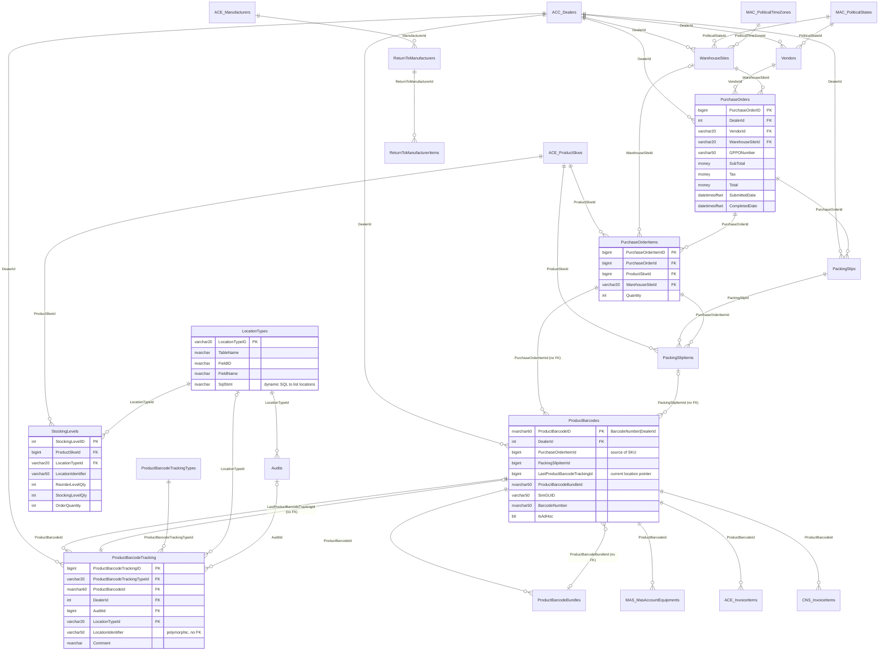
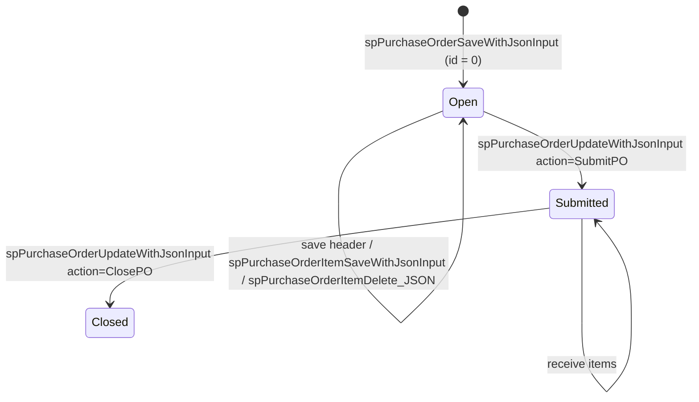
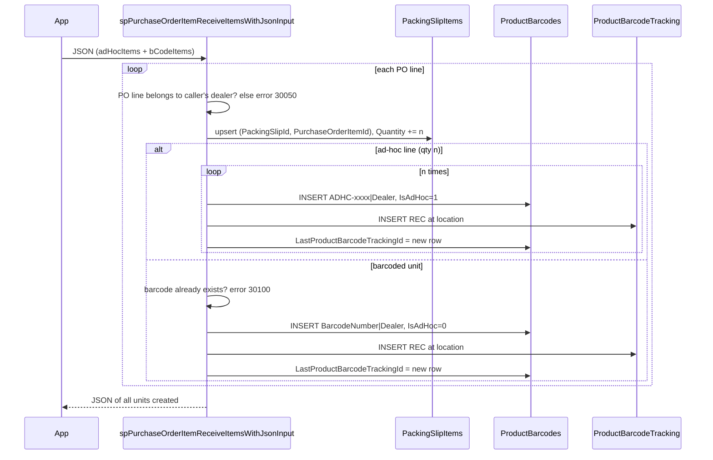

# INE: Inventory Engine (legacy NVL9_MAIN), how it works

> Reverse-engineered on 2026-11-17 from the live `NVL9_MAIN` database on DESKTOP-GAHBRKG (read-only, via `sys` catalog views and `OBJECT_DEFINITION`).
> Raw extraction lives next to this file: [source/INE_catalog.txt](source/INE_catalog.txt) (columns, keys, FKs, dependencies, row counts) and [source/INE_all_modules.sql](source/INE_all_modules.sql) (every view, proc and function body).
> Purpose: understand the engine well enough to adapt it into the Solasta Lighting Design database.

---

## 1. Inventory of objects

| Object type | Count | Notes |
|---|---|---|
| Tables | 15 | All with clustered PKs. No secondary indexes, no CHECK constraints, no UNIQUE constraints. |
| Foreign keys | 28 | 15 internal to INE, 10 outbound to `ACC`/`ACE`/`MAC`, 3 inbound from `MAS`/`ACE`/`CNS`. |
| Default constraints | 113 | Mostly the standard audit columns. |
| Views | 15 | All generated `vwGen_<Table>` row-level-security views. |
| Stored procedures | 62 | 45 generated `spAutoGen_<Table>_CREATE/UPDATE/DELETE`, 17 hand-written. |
| Functions | 6 | 3 scalar, 3 multi-statement table-valued. |
| Triggers, sequences, synonyms, user types | 0 | All business rules live in procs. |

### Tables and live row counts

| Table | Rows | Role |
|---|---|---|
| `Vendors` | 13 | Suppliers you buy from. |
| `WarehouseSites` | 12 | Physical stocking locations (default `CORP`). |
| `PurchaseOrders` | 66 | PO header. |
| `PurchaseOrderItems` | 264 | PO lines (SKU + qty + destination warehouse). |
| `PackingSlips` | 104 | Vendor shipments against a PO. |
| `PackingSlipItems` | 0 | Lines on a packing slip (built during receiving; unused in practice). |
| `ProductBarcodes` | 6,038 | **One row per physical unit.** The core aggregate. |
| `ProductBarcodeTracking` | 18,039 | Append-only movement/event ledger per unit. |
| `ProductBarcodeTrackingTypes` | 24 | Event type lookup (`REC`, `TRNF`, `CUST`, ...). |
| `LocationTypes` | 6 | Polymorphic location registry (`Received`, `Technician`, ...). |
| `Audits` | 13 | Physical count sessions at a location. |
| `StockingLevels` | 0 | Min/max reorder rules per SKU per location (unused). |
| `ProductBarcodeBundles` | 0 | Grouping of barcodes (unused). |
| `ReturnToManufacturers` | 1 | RMA header. |
| `ReturnToManufacturerItems` | 2 | RMA lines (free-text, not linked to barcodes). |

Every table carries the same audit block: `IsActive`, `IsDeleted` (soft delete), `ModifiedDate`, `ModifiedById`, `CreatedDate`, `CreatedById` (GUID, default is a hard-coded system user `E6872B58-...`), and `DEX_ROW_TS` (plus `DEX_ROW` identity on lookup tables). These are Dynamics GP (eConnect/DEX) conventions; `GPPONumber` and `GPEmployeeId` confirm the engine was built to sit beside Great Plains.

---

## 2. Domain model

The engine is **serialized-unit inventory**. There is no on-hand quantity column anywhere. Stock is *derived*: each physical unit is a `ProductBarcode`, every event that happens to it is appended to `ProductBarcodeTracking`, and a unit's **current location is the location on its latest tracking row**. On-hand at a location = count of units whose latest event points there.

Bounded contexts as built:

1. **Procurement**: `Vendors`, `WarehouseSites`, `PurchaseOrders` → `PurchaseOrderItems`.
2. **Receiving**: `PackingSlips` → `PackingSlipItems`, which create the units.
3. **Unit tracking (the core)**: `ProductBarcodes` + `ProductBarcodeTracking` + `ProductBarcodeTrackingTypes` + `LocationTypes`.
4. **Counting and replenishment**: `Audits`, `StockingLevels`.
5. **Reverse logistics**: `ReturnToManufacturers` → `ReturnToManufacturerItems`.

### Key design decisions

- **Natural composite string keys for units.** `ProductBarcodeID = '<BarcodeNumber>|<DealerId>'` (for example `ABC123|2000`). This makes barcode numbers unique per dealer (tenant) without a unique index. `fxGetBarcodeNumberBreakOut` splits it back apart.
- **Ad-hoc (non-serialized) units.** Items without a manufacturer barcode still get one row per unit, with a synthetic id `ADHC-<39 random alphanumerics>|<DealerId>` from `fxGetAdHocRandomBarcodeId`, and `IsAdHoc = 1`. Readers detect them by the `ADHC` prefix and aggregate them as a count per SKU instead of listing them. So the engine treats bulk stock as "anonymous serials". Live data has 0 ad-hoc units; all 6,038 are real barcodes.
- **Product identity is inherited, not stored.** `ProductBarcodes` has no `ProductSkwId`. The SKU of a unit is found through `ProductBarcodes.PurchaseOrderItemId → PurchaseOrderItems.ProductSkwId → ACE.ProductSkws`. Consequence: **every unit must originate from a PO line**; there is no way to create stock from an opening balance, a return, or a transfer-in without a PO.
- **Polymorphic locations.** A location is the pair `(LocationTypeId, LocationIdentifier)`. `LocationTypes` describes, for each type, which table and key column the identifier points at, plus a `SqlStmt` used to list the valid locations of that type. There is no FK on `LocationIdentifier`; integrity is by convention.
- **Denormalized "current" pointer.** `ProductBarcodes.LastProductBarcodeTrackingId` points at the latest tracking row so that current location is one join away. Every write proc updates it after inserting the tracking row. (Verified: all 6,038 pointers currently agree with the true latest active row.)
- **Multi-tenancy by `DealerId`.** Every aggregate root carries `DealerId` (FK to `ACC.Dealers`). Reference data with `DealerId = 0` is shared across dealers. The caller's dealer is never a parameter; it's read from `ACC.fxGetContextUserTable()`, which resolves the user from `CONTEXT_INFO()` set by the app on each connection.

### Location types (reference data)

| LocationTypeID | Points at | Identifier |
|---|---|---|
| `Received` | `INE.WarehouseSites` | `WarehouseSiteID` (warehouse stock) |
| `Transfer` | `INE.WarehouseSites` | `WarehouseSiteID` (in-transit / transfer target) |
| `Technician` | `RSU.UserResources` | `UserResourceID` (truck stock) |
| `SalesRep` | `RSU.UserResources` | `UserResourceID` |
| `Sold` | `ACE.MasterFileAccounts` | `MasterFileAccountID` (installed at customer; `SqlStmt` is a placeholder `SELECT 'Andres'`) |
| `Returned` | `INE.Vendors` | `VendorID` |

### Tracking (event) types

`IsInventoryMove = 1` means the event is meant to move the unit; `0` means an annotation. **Note: no code reads `IsInventoryMove`.** Every event, including audits, becomes the unit's "latest row" and therefore its current location.

| Move events (`IsInventoryMove = 1`) | Annotation events (`0`) |
|---|---|
| `REC` Receive shipment | `AUD` Audit performed |
| `TRNF` Transferred to technician | `AUD-MISS` Audit: equipment missing |
| `WRHOUSE` Transferred to warehouse | `DEF` Declared defective |
| `CUST` Sold to customer | `LOST` Reported lost |
| `DEALR` Sold to dealer | `EMP-PAID` Paid by employee |
| `DEL` Removed from customer | `INB` / `OUT` Inbound / outgoing transfer order |
| `REM` Removed during service call | `MBA` Master barcode assignment |
| `REM-AUD` Removed for year-end audit | `NUM` Rebate check numbered |
| `RET` Defective returned | `REF` Submitted for refurbishment |
| `SHIP-VEND` Shipped back to vendor | `SUB` Submitted for reconciliation |
| `WRT-OFF` Written off | |
| `EBAR` / `NBAR` Barcode replaced (old → new) | |

What the live ledger actually contains:

| Event | Location type | Rows |
|---|---|---|
| `REC` | Received | 6,038 |
| `REC` | Technician | 3,404 |
| `AUD-MISS` | Received | 2,276 |
| `AUD` | Received | 2,150 |
| `CUST` | Sold | 1,738 |
| `REC` | Transfer | 1,388 |
| `AUD` | Technician | 463 |
| `AUD-MISS` | Technician | 324 |
| `REC` | (null) | 251 |
| `DEL` | Received | 7 |

So in practice the business used `REC` for transfers too (rather than `TRNF`/`WRHOUSE`), and only `REC`, `AUD`, `AUD-MISS`, `CUST`, `DEL` were ever exercised. All 18,039 rows share the same `CreatedDate` (2017-08-17), so this ledger was bulk-loaded by a migration rather than accumulated through the UI.

---

## 3. Entity-relationship diagram



Relationships marked "no FK" are enforced only by procedure code.

---

## 4. Flows

### 4.1 Purchase order lifecycle

Status is **derived, not stored** (`spPurchaseOrderSearch`):

```
SubmittedDate IS NULL                       -> 'Open'
SubmittedDate set, CompletedDate IS NULL    -> 'Submitted'
both set                                    -> 'Closed'
```



- `spPurchaseOrderSaveWithJsonInput`: `id = 0` creates (dealer from context), otherwise verifies the PO belongs to the caller's dealer and updates. Returns `fxGetPurchaseOrderAsJson`.
- `spPurchaseOrderItemSaveWithJsonInput`: validates PO, SKU and warehouse are present and the line belongs to the dealer; creates or updates; returns `fxGetPurchaseOrderItemAsJson`.
- `spPurchaseOrderItemDelete_JSON`: soft delete (`IsActive = 0, IsDeleted = 1`).
- `spPurchaseOrderUpdateWithJsonInput`: only `SubmitPO` or `ClosePO`. Dates are converted to the dealer's time zone with `UTL.fxGetDateTimeOffsetFromDateByTimeZoneId`.
- Nothing prevents editing lines after submit, closing an unsubmitted PO, or receiving against a closed PO. Status transitions are not guarded.
- `spPurchaseOrderSearch` returns the PO with its lines (`quantity`, `received`, `outstanding`) and packing slips. `received` = count of `REC` tracking rows for units on that line (`fxGetPurchaseOrderItemAssignments`).

### 4.2 Receiving (the only way units are created)

`spPackingSlipeSaveWithJsonInput` creates or updates the packing slip header (arrival and close dates are stamped with the warehouse's time zone offset).

`spPurchaseOrderItemReceiveItemsWithJsonInput` takes:

```json
{
  "packingSlipId": 12,
  "productBarcodeTrackingTypeId": "REC",
  "locationTypeId": "Received",
  "locationIdentifier": "CORP",          // optional, falls back to the PO line's WarehouseSiteId
  "adHocItems": [ { "purchaseOrderItemId": 101, "qty": 5 } ],
  "bCodeItems": [ { "purchaseOrderItemId": 102, "barcodeNumber": "SN-0001" } ]
}
```



There is **no check against ordered quantity**: you can receive more units than the PO line asked for.

### 4.3 Moving units (transfers, sales, removals)

All moves are "append a tracking row, then repoint `LastProductBarcodeTrackingId`".

- **Serialized**: `spProductBarcodeAssignToLocation(@BarcodeNumber, @TypeId, @LocationTypeID, @LocationIdentifier, @Comment)`. The JSON wrapper `spProductBarcodeAssignToLocationWithJsonInput` loops over `barcodes[]` and returns the destination's inventory.
- **Ad-hoc / bulk**: `spProductBarcodeAssignAddHoc(@Skw, @Qty, ..., @SrcLocationTypeID, @SrcLocationIdentifier, ...)`. Checks the source has at least `@Qty` ad-hoc units of that SKU, then picks the oldest ones (FIFO by tracking id) and moves them. JSON wrapper `spProductBarcodeAssignAddHocWithJsonInput` loops over `items[] {skw, qty}`.
- **Sale / install**: `MAS.spMasAccountEquipmentCreate` (alarm-account equipment) calls `spProductBarcodeAssignToLocation` with type `CUST` to move the unit to the customer account. `MAS.spMasAccountEquipmentDelete` reverses it by soft-deleting the latest `CUST` tracking row.

### 4.4 Reading inventory

Two different strategies exist for "where is it now":

| Reader | Strategy |
|---|---|
| `fxGetLocationInventory` → `spGetLocationInventory`, `spProductBarcodeAssignAddHoc` | Join `ProductBarcodes.LastProductBarcodeTrackingId` to the tracking row; filter by location. Does not check that tracking row's `IsDeleted`. |
| `spGetTechnicianInventory`, `spGetInventoryByLocationAndIdentifier` | `ROW_NUMBER() OVER (PARTITION BY ProductBarcodeId ORDER BY TrackingID DESC)` across active, non-deleted tracking rows. |

Outputs aggregate per SKU, list barcodes for serialized units, and collapse ad-hoc units to `ADHC-XXX...XXX` with a count. `spGetInventoryByLocationAndIdentifier` only supports `Technician`, `SalesRep` and `Received` (others raise `30400 FEATURE NOT IMPLEMENTED`).

Other read procs: `spGetMetaData` (vendors, warehouses, location types and tracking types as one JSON blob for UI bootstrapping), `spLocationsGetByLocationTypes` (runs the `LocationTypes.SqlStmt` with `sp_executesql` and `@DealerId`), and `spProductBarcodeTrackingHistoryGETByBarcodeJSON` (full event history of a unit).

### 4.5 Audits, stocking levels, RMAs, bundles

These are modeled but have **no business procs**, only the generated CRUD. Audits appear indirectly as `AUD` / `AUD-MISS` tracking rows carrying `AuditId`. `StockingLevels` and `ProductBarcodeBundles` are empty. RMA items are free text and are not linked to barcodes, so returning a unit to a vendor (`SHIP-VEND`) and the RMA document are not connected.

---

## 5. How rules are enforced

There are no triggers or CHECK constraints, so **every rule is in procedure code**.

1. **Tenant isolation.** Hand-written procs call `ACC.fxGetContextUserTable()` to get `UserID` and `DealerId` from `CONTEXT_INFO()`, then filter or validate by `DealerId`. Error codes: `30050` security violation, `30100` not found or duplicate, `30400` not implemented, `30500` validation.
2. **Table-level ACL (generated layer).** `spAutoGen_*` procs call `GEN.fxGetAccessLevel('CREATE'|'UPDATE'|'DELETE', 'INE', '<Table>')` and raise `50100/50120/50130` if the user lacks the right. Generated deletes are soft deletes.
3. **Row-level read security.** `vwGen_*` views join `GEN.fxGetAccessLevel('Read', ...)`: `ReadAccessId = 2` sees all rows, `1` sees only rows it created; deleted rows hidden.
4. **Error handling.** `BEGIN TRY ... CATCH EXEC GEN.spExceptionsThrown` everywhere. No explicit transactions anywhere in INE.
5. **API style.** Inputs and outputs are JSON (`OPENJSON` in, `FOR JSON PATH` out as a single column `JsonOutPutMethod`), camelCase properties. The procs are effectively the application's service layer.

---

## 6. External dependencies

| Schema | Object | Used for |
|---|---|---|
| `ACC` | `Dealers` (FK x6), `fxGetContextUserTable`, `fxGetUserInfoByUserIdTABLE`, `fxGetUserInfoByUserIdJSONTABLE`, `vwUserSummaryInfo` | Tenant, current user, audit-user display |
| `ACE` | `ProductSkws` (FK x3), `Manufacturers` (FK), `MasterFileAccounts` (via `Sold` location) | Product catalog, customer accounts |
| `MAC` | `PoliticalStates`, `PoliticalTimeZones` | Addresses and local time |
| `RSU` | `UserResources` (+ `UserRecruits` in `LocationTypes.SqlStmt`) | Technicians and sales reps as locations |
| `GEN` | `fxGetAccessLevel`, `fxGetUserInfo`, `spExceptionsThrown` | ACL and error plumbing |
| `UTL` | `fxGetAlphaNumericRandom`, `fxGetDefaultGuidId`, `fxGetDateTimeOffsetFromDateByTimeZoneId` | Helpers |

Inbound (things that depend on INE): `MAS.MasAccountEquipments`, `ACE.InvoiceItems`, `CNS.InvoiceItems` (FKs to `ProductBarcodes`), and MAS procs `spMasAccountEquipmentCreate`, `spMasAccountEquipmentDelete`, `spMasAccountEquipmentByBarcode`, `spMasAccountEquipmentByAdHocSkw`.

---

## 7. Defects and risks found in the code

These are worth fixing rather than porting as-is.

1. **No transactions.** Receiving and moves insert into three tables per unit with no `BEGIN TRAN`. A failure mid-batch leaves partial receipts and possibly a stale `LastProductBarcodeTrackingId`.
2. **`ClosePO` stamps the wrong date.** In `spPurchaseOrderUpdateWithJsonInput` the `CompletedDate` branch converts `SubmittedDate`, not `CompletedDate`.
3. **No over-receipt or status guard.** Receiving ignores ordered quantity and PO status.
4. **Moves don't validate the unit.** `spProductBarcodeAssignToLocation` never checks the barcode exists, belongs to the dealer, or is currently at a plausible source. A missing barcode only fails on the FK.
5. **Wrong security check for non-person locations.** `spProductBarcodeAssignToLocationWithJsonInput` always validates `LocationIdentifier` against `RSU.UserResources`, so moving to a warehouse (`Received`/`Transfer`) is rejected unless an id happens to collide with a user resource id.
6. **`IsInventoryMove` is ignored.** Annotation events (`AUD`, `AUD-MISS`, `LOST`, `DEF`) become the latest row and therefore change "current location". An `AUD-MISS` row leaves the unit counted as on hand where it went missing.
7. **Undo leaves a dangling pointer.** `MAS.spMasAccountEquipmentDelete` soft-deletes the `CUST` row but does not repoint `LastProductBarcodeTrackingId`, and `fxGetLocationInventory` doesn't filter deleted tracking rows, so the unit stays "at the customer" in that reader while the `ROW_NUMBER` readers move it back. (No live rows are affected today.)
8. **Two "current location" algorithms** (pointer vs `ROW_NUMBER`) that can disagree, see item 7.
9. **Leaked cursor / unreachable `RETURN`.** In the receive proc, `RAISERROR` severity 18 inside `TRY` jumps to `CATCH`, so the `CLOSE/DEALLOCATE` and `RETURN` after it never run. (The database default is local cursors, so the leak is limited to the batch.)
10. **Wasted id in the ad-hoc loop.** The first `fxGetAdHocRandomBarcodeId` call before the loop is discarded.
11. **Dynamic SQL from a table** (`LocationTypes.SqlStmt` via `sp_executesql`). Parameterized for `@DealerId`, but anyone who can update `LocationTypes` can run arbitrary SQL. Also `Sold` has a placeholder statement.
12. **No secondary indexes.** Every inventory read scans `ProductBarcodeTracking` (18k rows today, fine; not fine at scale). At minimum: `(ProductBarcodeId, ProductBarcodeTrackingID DESC)`, `(LocationTypeId, LocationIdentifier)`, `ProductBarcodes(PurchaseOrderItemId)`, `ProductBarcodes(LastProductBarcodeTrackingId)`.
13. **Smaller things.** Typo'd names (`spPackingSlipeSave...`, JSON key `modifidedBy`), `CompletedDate` parsed but unused in PO save, `WITH(NOLOCK)` on reads and even on `UPDATE` targets, and `nvarchar` keys handled as `varchar` in several procs (`ProductBarcodeId` is `nvarchar(60)` in the table but `VARCHAR(60)`/`VARCHAR(50)` in some proc parameters; today's ad-hoc ids are 49 characters, so there is almost no headroom).

---

## 8. Porting notes for Solasta Lighting Design

### What's worth keeping

- **The ledger model.** Units plus an append-only event log with typed events is a sound, auditable core and maps well to DDD (one `InventoryUnit` aggregate, events as the source of truth).
- **Polymorphic location as `(LocationType, Identifier)`.** For lighting design this naturally covers warehouse, staging/kitting area, installer van, project site, and returned-to-vendor.
- **Derived PO status and the `quantity / received / outstanding` projection.**
- **Event type catalog with an "is a move" flag**, provided code actually honours it.

### What to change

1. **Support quantity-tracked stock, not just serials.** Most lighting stock (LED tape by the metre, drivers, connectors, mounting hardware) isn't individually barcoded, and the ad-hoc trick of a synthetic row per unit won't scale to reels of tape measured in feet. Recommended: a `StockItem` (SKU) with a `TrackingMode` of `Serialized | Lot | Quantity`, a movement ledger with `Quantity` and `UnitOfMeasure` (so 32.8 ft of tape is one movement), and a `StockBalance` projection per (SKU, location, lot). Keep per-unit records only for serialized gear (fixtures, controllers, gateways).
2. **Store SKU on the unit/movement directly.** Don't derive it through the PO line; allow opening balances, adjustments, customer returns and transfers that don't originate from a PO.
3. **Map to Solasta's catalog.** Replace `ACE.ProductSkws` with the Solasta product/fixture catalog tables, `ACC.Dealers` with Solasta's tenant/company concept (or drop `DealerId` if Solasta is single-tenant), `RSU.UserResources` with Solasta's users/installers, and `ACE.MasterFileAccounts` with Solasta projects (a `Project` location type, and allocation of stock to a project's fixture schedule).
4. **Add project allocation / reservation.** The legacy engine has no "reserved" state. A lighting design workflow will want stock reserved against a project's bill of materials before it ships. Model it as an allocation table or as `Reserved` movements.
5. **Enforce invariants in the database where cheap.** Real FKs or a filtered unique index for barcodes per tenant, CHECK constraints on quantities, one transaction per business operation, and a single "current location" rule that respects `IsInventoryMove` and soft deletes. Consider removing the denormalized pointer in favour of an indexed view or a maintained balance table.
6. **Replace `CONTEXT_INFO()` with `SESSION_CONTEXT(N'UserId')`** (keyed, can be read-only), or pass the user explicitly.
7. **Replace dynamic SQL in `LocationTypes`** with one view per location type or a `vw_Locations` union.
8. **Follow the Solasta repo conventions** (`DATABASE_CONSTITUTION.md`): one object per file, `sp_`/`fn_`/`vw_` prefixes, `IX_`/`UQ_`/`CK_` naming, idempotent transactional migrations under `Migrations/`, and a new schema folder (suggested `INV` or `INE`) registered alongside the existing `ACC`, `ACE`, `MAC`, `MAS`, and other schema folders. The generated `spAutoGen_*` / `vwGen_*` layer can be dropped if Solasta's API layer handles CRUD and authorization.
9. **Drop or rebuild unused pieces deliberately.** `StockingLevels` (reorder points) is genuinely useful for drivers and connectors, so keep the idea. `ProductBarcodeBundles` and the GP-specific columns (`DEX_ROW`, `DEX_ROW_TS`, `GPPONumber`) can go unless Solasta integrates with an accounting system; RMAs should link to units or movements.
10. **Data migration is optional.** The legacy data is one bulk load from 2017 with almost no ongoing activity, so porting the design matters far more than porting the rows.
